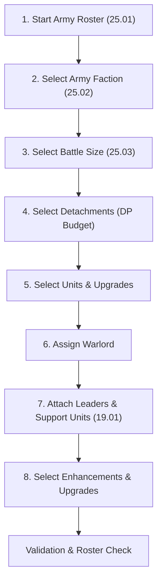

# Warhammer 40,000 11th Edition — Core Rules & Army Building Reference

This reference document compiles and codifies all core rules, army construction mechanics, unit lifecycle constraints, and validation logic from the official **Warhammer 40,000 11th Edition Core Rules** and the **BSData/wh40k-11e** data architecture.

---

## 1. System Identity & 11th Edition Core Innovations

Warhammer 40k 11th Edition refines the army construction system by introducing structured resource budgets and dual-attachment mechanics:

1. **Detachment Points (DP)**: Detachments now cost Detachment Points (DP). Players receive a DP budget based on the battle size to purchase detachments.
2. **Dual-Attachment Architecture (Leader + Support)**: Bodyguard units can attach up to **one Leader unit** AND **one Support unit** simultaneously. All Support units in a roster must be attached to a bodyguard unit.
3. **Enhancements vs. Upgrades**:
   - Standard **Enhancements** are restricted to non-Epic Hero `CHARACTER` units and are unique per army.
   - **Upgrades** are a special classification of enhancements that can be assigned to non-`CHARACTER` units and may be duplicated up to 3 times in an army (instances 2 and 3 do not count towards the army enhancement quota, though their points must be paid).
   - An attached unit can never carry more than one enhancement/upgrade across the entire attached unit.
4. **New Weapon Abilities**:
   - `[CLEAVE X]`: Adds $X$ additional attack dice for every 5 models in the target unit (rounding down) when concentrating all attacks on a single target.
   - `[CLOSE-QUARTERS]`: Replaces/functions identically with `[PISTOL]`, allowing shooting while in engagement range.

---

## 2. Army Roster Construction Lifecycle (Section 25: Muster Armies)

Every army roster must follow the sequential steps in **Section 25 (Muster Armies)**:

### Step 1: Start Your Army Roster (25.01)
Record all army selections, models, equipment, points values, detachment selections, warlord, and attachments.

### Step 2: Select Army Faction (25.02)
- Select exactly **one faction keyword** to be your **Army Faction** (e.g. `ADEPTUS ASTARTES`, `NECRONS`, `AELDARI`, `ORKS`, `CHAOS SPACE MARINES`).
- Every non-allied unit in the roster must have this faction keyword.

### Step 3: Select Battle Size (25.03)
The battle size establishes the hard validation limits for the entire roster:

| Battle Size | Points Total | Detachment Points (DP) | Enhancement Limit | Datasheet Limit (Standard) | Datasheet Limit (BATTLELINE / DEDICATED TRANSPORT) | EPIC HERO Limit |
| :--- | :---: | :---: | :---: | :---: | :---: | :---: |
| **Incursion** | **1,000 pts** | **2 DP** | **2** | **2** | **4** | **1** |
| **Strike Force** | **2,000 pts** | **3 DP** | **4** | **3** | **6** | **1** |
| **Onslaught** | **3,000 pts** | **4 DP** | **6** | **4** | **8** | **1** |

> [!IMPORTANT]
> **Incursion 3DP Detachment Exception (25.04)**: If playing an **Incursion** battle (1,000 pts), a player is permitted to select a **3 DP detachment as their only detachment**, despite the normal 2 DP limit.

### Step 4: Select Detachments (25.04)
- Players spend their DP budget to unlock detachments available to their Army Faction.
- **Uniqueness**: You cannot select the same detachment more than once.
- **Inclusions / Exclusions**: Detachment rules may mandate or prohibit specific units, subfactions, or other detachments.
- Detachments grant access to:
  - Detachment Rules
  - Enhancements & Upgrades
  - Stratagems

### Step 5: Select Units (25.04)
- Units must have the selected Army Faction keyword, or be validly permitted by an allied inclusion rule (e.g., Assigned Agents, Freeblades, Dreadblades, Daemonic Pact, Brood Brothers).
- Models take default equipment and valid wargear options per their datasheet composition rules.
- Model counts must strictly adhere to the unit's minimum and maximum starting sizes. Points are assessed based on unit size brackets or per-model costs.

### Step 6: Select WARLORD (25.04)
- Select exactly **one `CHARACTER` unit** with the Army Faction keyword.
- Designate exactly **one `CHARACTER` model** in that unit to be the **WARLORD** (gains the `WARLORD` keyword).
- **Mandatory Warlord Rules**: If a unit's datasheet states it must be your Warlord (e.g. Supreme Commanders like Roboute Guilliman, Abaddon the Despoiler, Ghazghkull Thraka), you must choose one such unit.
- **Negative Precedence**: Rules stating a model *cannot* be your Warlord take precedence over rules stating it *must* be your Warlord.

### Step 7: Attach Leaders and Support Units (19.01 & 25.04)
- Heroic units with `LEADER` (24.22) or `SUPPORT` (24.34) can be attached to eligible `BODYGUARD` units listed on their datasheet or in the Munitorum Field Manual.
- **Dual Slot Limit**: Each `BODYGUARD` unit can have at most:
  - **1 Leader Unit**
  - **1 Support Unit**
- **Support Unit Mandate**: Each `SUPPORT` unit in your roster **must** be attached to a bodyguard unit. It cannot be deployed standalone.
- **Attached Unit Statline**:
  - Attacks against the attached unit use the highest Toughness ($T$) of the bodyguard models while any bodyguard models remain.
  - The attached unit possesses all keywords of all its active component models.

### Step 8: Select Enhancements and Upgrades (25.04)
- Purchased from the pool of enhancements granted by selected detachments. Points are added to the assigned unit.
- **Standard Enhancements**:
  - Can only be given to `CHARACTER` units (select one character model if unit has multiple models).
  - Cannot be given to `EPIC HERO` units.
  - Unique per army (no duplicate of the same enhancement).
- **Upgrades**:
  - Enhancements tagged with `'Upgrade'`.
  - Can be given to non-`CHARACTER` units.
  - Up to 3 copies of the same Upgrade may be taken in an army.
  - 2nd and 3rd instances do not count toward the Enhancement slot limit, but their points must be paid.
- **Global Attachment Constraint**: **No unit (including attached units) can have more than one enhancement or upgrade.**

---

## 3. Special Unit Types & Structural Restrictions

### Dedicated Transports (Section 18.01)
- Must be assigned passengers: in the Declare Battle Formations step, **every Dedicated Transport must have a friendly unit embarked within it**.
- Dedicated Transports without an embarked unit are destroyed at the end of deployment.
- Hard quantity limit: Twice the standard battle size unit limit (4 in Incursion, 6 in Strike Force).

### Strategic Reserves (Section 20.01)
- The combined points value of units placed in Strategic Reserves (including embarked passengers in reserved transports) cannot exceed **50% of your total battle size points**.
- `FORTIFICATION` units can never be placed in Strategic Reserves.

### Epic Heroes (Section 02 / 25.03)
- Hard limit of **1 instance per specific Epic Hero datasheet** across the entire army, regardless of battle size.
- Cannot receive Enhancements.
- Can attach to a Bodyguard unit that carries an Upgrade/Enhancement.

### Sub-Faction & Divergent Chapter Exclusivity
- Sub-factions belonging to the same overarching parent faction (e.g. Adeptus Astartes Chapters: Ultramarines, Blood Angels, Dark Angels, Space Wolves, Black Templars) are mutually exclusive.
- Taking units or detachments with one specific Chapter keyword forbids the inclusion of units with another divergent Chapter keyword.

### Allied Faction Quotas
- **Assigned Agents (`AGENTS OF THE IMPERIUM`)**:
  - *Incursion*: Max 1 Retinue, 1 Character, 1 Requisitioned.
  - *Strike Force*: Max 2 Retinue, 2 Character, 1 Requisitioned.
  - *Onslaught*: Max 3 Retinue, 3 Character, 2 Requisitioned.
- **Imperial Knights (`FREEBLADES`)**:
  - 1 `TITANIC` Knight or up to 3 `ARMIGER` models in an Imperium army.
- **Chaos Knights (`DREADBLADES`)**:
  - 1 `TITANIC` Knight or up to 3 `WAR DOG` models in a Chaos army.
- **Chaos Daemons (`DAEMONIC PACT`)**:
  - Up to 25% of total army points, matching Chaos allegiance.
- **Genestealer Cults (`BROOD BROTHERS`)**:
  - Up to 25% of army points taken from Astra Militarum datasheet library.

---

## 4. BSData (`wh40k-11e`) Data Structure & Architecture

The repository at `BSData/wh40k-11e` uses clean **JSON** representations of the BattleScribe format:

### Root Types
- **Game System (`Warhammer 40,000.json`)**: Contains `gameSystem` root object.
  - Defines `costTypes`:
    - `pts` (`51b2-306e-1021-d207`)
    - `Detachment Points` (`82ae-1066-5107-6ae0`)
    - `Enhancements` (`f759-1bc4-cb3a-f0d2`)
  - Defines global `categoryEntries`, `profileTypes`, `forceEntries`, `sharedRules`.
- **Catalogue Files (`<Faction>.json`)**: Contains `catalogue` root object.
  - `library: true` denotes reusable libraries (e.g., `Aeldari - Aeldari Library.json`, `Imperium - Space Marines.json`).
  - `library: false` denotes playable standalone or sub-faction catalogues (e.g., `Imperium - Blood Angels.json`).
  - `catalogueLinks`: Array linking to parent catalogues or libraries with `importRootEntries: true`.

### Core Data Hierarchy within Catalogues
1. **`entryLinks`**: Pointers to selection entries, either in the current catalogue or an imported library.
2. **`sharedSelectionEntries` / `selectionEntries`**:
   - `type: 'unit' | 'model' | 'upgrade'`
   - `costs`: Array of costs (`pts`, `Detachment Points`, `Enhancements`).
   - `categoryLinks`: Keyword tags and slot classifications (`primary: true` marks primary role, e.g. `Battleline`, `Character`, `Epic Hero`).
   - `selectionEntryGroups`: Child options (e.g., unit squad size toggles, weapon options, wargear swappable groups).
   - `constraints`: Upper/lower bounds on counts, costs, or associations.
   - `modifiers` & `modifierGroups`: Reactive rules that modify point costs, names, constraints, or hidden status based on selections elsewhere in the tree.
   - `profiles`: Datasheet profile stats (`Move`, `Toughness`, `Save`, `Invulnerable Save`, `Wounds`, `Leadership`, `Objective Control`, weapon profiles, abilities).

### Associations & Attachments in Data
- Attachment constraints use `field: 'associations'` with targets `Leader` (`childId: 1556-9b56-fba6-4370`) and `Support` (`childId: 7dcd-7f61-69a7-0294`), enforcing the 1-Leader and 1-Support maximum per bodyguard unit.
- Enhancement constraints use `field: 'f759-1bc4-cb3a-f0d2'` with `traverseAssociationGroup: true` to prevent attached units from taking more than 1 enhancement in total.

---

## 5. Army Builder Validation Engine Matrix

When building and validating an army list, the app must execute and display the following checks:

| Validation Rule | Severity | Trigger Condition |
| :--- | :---: | :--- |
| **Points Limit** | Error | Total `pts` > Selected Battle Size Points (1,000 / 2,000 / 3,000) |
| **DP Limit** | Error | Total `Detachment Points` > DP Budget (unless Incursion 3DP single-detachment rule applies) |
| **Duplicate Detachment** | Error | Same Detachment selected > 1 time |
| **Enhancement Quota** | Error | Non-Upgrade Enhancements + first instances of Upgrades > Enhancement Limit |
| **Enhancement Attached Limit** | Error | Any unit or attached combination has > 1 Enhancement/Upgrade |
| **Enhancement on Character** | Error | Standard Enhancement assigned to non-`CHARACTER` or `EPIC HERO` |
| **Duplicate Enhancements** | Error | Same standard Enhancement taken > 1 time |
| **Upgrade Duplicate Limit** | Error | Same Upgrade taken > 3 times |
| **Datasheet Duplication** | Error | Instances of identical datasheet > Battle Size limit (2 / 3 / 4) |
| **Battleline / Dedicated Transport Limit** | Error | Instances of Battleline / Dedicated Transport > Double Battle Size limit (4 / 6 / 8) |
| **Epic Hero Uniqueness** | Error | Instances of identical Epic Hero > 1 |
| **Warlord Designation** | Error | Exactly 1 Warlord not designated |
| **Warlord Faction Match** | Error | Warlord model does not belong to Army Faction |
| **Mandatory Warlord** | Error | Roster contains a mandatory Warlord unit that is not designated Warlord |
| **Support Unit Attachment** | Error | Any `SUPPORT` unit in roster is not attached to a bodyguard unit |
| **Bodyguard Slot Capacity** | Error | Bodyguard unit has > 1 Leader or > 1 Support unit attached |
| **Dedicated Transport Embarkation** | Warning / Error | Dedicated Transport has 0 passengers assigned |
| **Strategic Reserves Cap** | Error | Points in Strategic Reserves > 50% of battle size points |
| **Sub-faction Exclusivity** | Error | Cross-chapter or divergent faction units mixed in the same roster |
| **Allied Quota Limits** | Error | Allied units exceed battle size allocations (e.g. Agents of Imperium retinue/character caps) |
| **Unit Minimum / Maximum Sizes** | Error | Models in squad < minimum or > maximum permitted |
| **Wargear Option Limits** | Error | Wargear selections exceed allowed weapon slot counts on datasheet |

---
*Reference compiled from Warhammer 40,000 11th Edition Core Rules & BSData wh40k-11e schema.*

