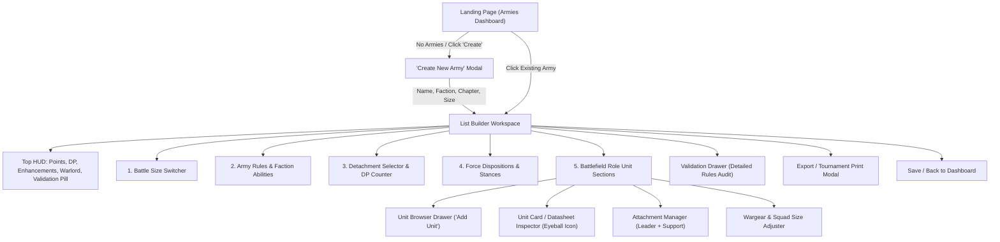

# Warhammer 40k 11th Edition Army Builder — Frontend Requirements Specification

This document codifies the complete functional, technical, UX, and architectural requirements for the web-friendly frontend of the **Warhammer 40,000 11th Edition Army Builder**.

---

## 1. System Architecture & Tech Stack

- **Framework**: React 18+ with TypeScript
- **Bundler & Build Tool**: Vite
- **Styling**: Tailwind CSS with custom Grimdark / Warhammer 40k theme (dark zinc/slate surfaces, gold/amber and imperial red accents, faction-colored badge highlights, monospace stat counters).
- **Icons**: Lucide React
- **Data Source**: Pre-indexed JSON payloads served by Express backend (`/api/factions`, `/api/factions/:id`, `/api/keywords`).
- **Persistence**: Client-side storage (`localStorage` / `IndexedDB`) for instantaneous saving, loading, duplicating, and restoring rosters, plus `.json` file Export & Import.

---

## 2. Information Architecture & User Flow

---

## 3. Screen Specifications

### Screen 1: Landing Page (Armies Dashboard)
- **Header**: App branding ("WARHAMMER 40,000 — 11th Edition Army Builder"), active edition badge, "New Army" primary button, "Import Roster JSON" button.
- **Empty State** (when no armies exist):
  - Stylized banner: *"No battle forces mustered yet, Commander."*
  - Prominent primary CTA: **"Create Your First Army"**.
  - Secondary CTA: **"Import Roster (.json)"**.
- **Populated State** (roster cards grid):
  - Each Army Card displays:
    - **Army Name** (user custom name, e.g., "1st Company Strike Force").
    - **Faction & Sub-Faction Badges** (e.g., `IMPERIUM` / `ADEPTUS ASTARTES` / `SALAMANDERS`).
    - **Battle Size & Points**: e.g., `Strike Force • 1,985 / 2,000 pts`.
    - **Detachment Points**: e.g., `2 / 3 DP • Forgefather's Seekers`.
    - **Validation Status Pill**: Green `✓ Valid Roster` or Red `⚠ 2 Issues`.
    - **Last Modified Timestamp**.
    - **Actions**: `Edit`, `Duplicate`, `Export JSON`, `Delete`.

---

### Screen 2: "Create New Army" Modal
Guided setup flow before entering the builder:
1. **Army Name**: Text input with placeholder (e.g., "Sons of Nocturne").
2. **Super-Faction Selector**: Filter tabs: `All`, `Imperium`, `Chaos`, `Xenos`, `Aeldari`.
3. **Primary Army Faction**: Dropdown / card grid with faction icons and titles (e.g. *Adeptus Astartes*, *Necrons*, *Imperial Knights*, *Astra Militarum*).
4. **Sub-Faction / Chapter**: Dynamic selector shown when a parent faction has sub-factions (e.g. for Adeptus Astartes: *Salamanders*, *Blood Angels*, *Dark Angels*, *Ultramarines*, *Space Wolves*, *Black Templars*, etc.). Automatically provisions sub-faction-specific datasheets, detachments, and exclusivity rules.
5. **Battle Size**:
   - `Incursion` (1,000 pts | 2 DP | Max 2 Enhancements | Unit Limit: 2 / Battleline: 4).
   - `Strike Force` (2,000 pts | 3 DP | Max 4 Enhancements | Unit Limit: 3 / Battleline: 6).
   - `Onslaught` (3,000 pts | 4 DP | Max 6 Enhancements | Unit Limit: 4 / Battleline: 8).
6. **Action**: "Begin Mustering Army" (initializes roster in storage and opens the builder).

---

### Screen 3: List Builder Workspace

#### A. Sticky Top Navigation HUD
- **Left**: Back to Armies button, editable Army Name, Faction / Chapter pill.
- **Center Stat Counters**:
  - **Points Counter**: `Current / Max pts` (color-coded: green if under, yellow if close, red if over budget).
  - **Detachment Points (DP)**: `Current / Max DP` (e.g., `2 / 3 DP`).
  - **Enhancement Counter**: `Current / Max Enhancements` (e.g., `2 / 4`).
  - **Warlord Badge**: Star icon indicating whether exactly one Warlord is designated.
- **Right Action Buttons**:
  - **Validation Pill**: Green `Army Valid` or Amber/Red badge with issue count. Clicking toggles the **Validation Drawer**.
  - **Save Army** button (with auto-save toast indicator).
  - **Export / Print** button (opens tournament text / print modal).

#### B. Scrollable Builder Sections

1. **Battle Size Switcher**:
   - Radio toggle to seamlessly switch between *Incursion* (1,000 pts), *Strike Force* (2,000 pts), and *Onslaught* (3,000 pts).
   - Dynamically recalculates points headroom, DP budgets, enhancement limits, and datasheet duplication limits.

2. **Army Rules & Faction Abilities**:
   - View/configure core faction mechanics (e.g., *Oath of Moment*, *Code Chivalric*, *Acts of Faith*, *Reanimation Protocols*, *Synapse*, *Waaagh!*).
   - Includes interactive rules text drawer so users don't need external rulebooks.

3. **Detachment Selection**:
   - Card grid of all available detachments for the selected faction and subfaction.
   - Shows Detachment Name, DP Cost badge (`1 DP`, `2 DP`, `3 DP`), and Category Tags (`Armigers`, `Priority Assets`, `Reconnaissance`).
   - **Eyeball Icon (👁)** on each card: Opens modal displaying complete Detachment Rules, restrictions, and enhancements.
   - **Smart Gating & Disabling**:
     - Detachments with conflicting tags (e.g., `Throne-bonded Outriders` vs. `Spearhead-at-Arms` both carrying `ARMIGERS`) are greyed out with tooltip: *"Tag Conflict: ARMIGERS"*.
     - Chapter-gated detachments (e.g., *Forgefather's Seekers*) are visible only when the matching Chapter is chosen.
     - Budget-aware: Shows remaining DP. Supports Incursion single 3DP detachment rule.

4. **Force Disposition Selection & Detachment Sub-Options**:
   - For detachments that offer strategic stances, dispositions, or vow choices (e.g., Black Templar Vows, Imperial Knights Foundations, Gladius Combat Doctrines).

5. **Battlefield Role Unit Sections**:
   Units in the army are grouped into distinct, collapsible sections:
   1. **Epic Heroes** (max 1 of each datasheet across the army, no enhancements).
   2. **Characters** (eligible for Warlord designation and detachment Enhancements).
   3. **Battleline** (double datasheet limit: 4 in Incursion, 6 in Strike Force).
   4. **Infantry** (core foot troops).
   5. **Mounted** (bikers and cavalry).
   6. **Monster** (beasts and bio-titans).
   7. **Vehicle** (tanks, walkers, artillery).
   8. **Dedicated Transport** (must embark passengers during deployment).
   9. **Aircraft** *(Added)* (fliers with flight minimums, hover modes, and reserve rules).
   10. **Fortifications** *(Added)* (static emplacements, terrain barriers).
   11. **Allied Units / Assigned Agents** *(Added)* (Assigned Agents, Freeblades, Dreadblades, Daemonic Pact).

   - **Section Header**: Role Title, Icon, Unit Count vs. Limit (e.g., `Battleline (2 / 6)`), and an **"+ Add [Role]"** button that launches the **Unit Browser Modal**.

---

### Screen 4: Unit Card & Interactive Datasheet Modal (The "Eyeball" Inspector)

#### A. Unit Card in the Roster
Each unit added to the roster displays:
- **Header**: Unit Name, Role Badge, Model Count, Total Points (including equipment & upgrades).
- **Warlord Star**: Clickable star icon on Character units to appoint or revoke Warlord designation.
- **Squad Size / Model Count Adjuster**: Stepper or dropdown (e.g. 5 models: 85 pts / 10 models: 170 pts) with real-time point scaling.
- **Enhancement & Upgrade Assigner**: Dropdown of eligible enhancements from selected detachments (with points increase and unique-per-army validation).
- **Dual-Attachment Widget** (11th Edition Leader + Support):
  - *If Bodyguard Unit*: Buttons to **"Attach Leader"** and **"Attach Support"**. When attached, nested child cards display beneath the bodyguard with visual connection brackets.
  - *If Leader or Support Unit*: Badge indicating which bodyguard unit it is currently assigned to (with warning if Support unit is unattached).
- **Dedicated Transport Passenger Slot**: Allows selecting friendly units in the roster to embark.
- **Action Buttons**:
  - **Eyeball Icon (👁)**: Launches the full Datasheet Inspector Modal.
  - **Duplicate Unit (⎘)**: Clones unit configuration if under datasheet limit.
  - **Delete Unit (🗑)**: Removes unit from roster.

#### B. Full Datasheet Inspector Modal
Clicking the Eyeball icon opens the comprehensive 40k datasheet card:

1. **Unit Header & Composition Makeup**:
   - Unit Name, Role, Base Size (`32mm`, `40mm`, etc.).
   - Model composition breakdown (e.g., `1 Intercessor Sergeant`, `4 Intercessors`).
   - Equipped wargear summary.

2. **Model Stat Profiles Table**:
   Common models grouped by profile name with quantity:
   | Model Profile | M | T | Sv | InSv | W | Ld | OC |
   | :--- | :---: | :---: | :---: | :---: | :---: | :---: | :---: |
   | **Intercessor (x4)** | 6" | 4 | 3+ | — | 2 | 6+ | 1 |
   | **Intercessor Sergeant (x1)** | 6" | 4 | 3+ | — | 2 | 6+ | 1 |

3. **Ranged Weapons Table**:
   Common weapons grouped with quantity:
   | Ranged Weapon | Range | A | BS | S | AP | D |
   | :--- | :---: | :---: | :---: | :---: | :---: | :---: |
   | **Bolt rifle (x4)** | 24" | 2 | 3+ | 4 | -1 | 1 |
   - **Clickable Keywords Row**: Underneath each weapon, tags like `[ASSAULT]`, `[HEAVY]`, `[RAPID FIRE 1]`, `[BLAST]`, `[CLEAVE 1]` appear as interactive clickable pills. Clicking pops up the official rule summary and description from `keywords.json`!

4. **Melee Weapons Table**:
   | Melee Weapon | Range | A | WS | S | AP | D |
   | :--- | :---: | :---: | :---: | :---: | :---: | :---: |
   | **Close combat weapon (x4)** | Melee | 3 | 3+ | 4 | 0 | 1 |
   | **Astartes chainsword (x1)** | Melee | 5 | 3+ | 4 | -1 | 1 |
   - **Clickable Keywords Row**: e.g., `[EXTRA ATTACKS]`, `[LANCE]`, `[LETHAL HITS]`.

5. **Abilities Section**:
   - **Core Abilities**: Pills for `Deep Strike`, `Infiltrators`, `Leader`, `Support`, `Stealth`, etc. (clickable for rules tooltip).
   - **Datasheet Abilities**: Name and detailed rules text.
   - **Faction Abilities**: Chapter / army specific rules.

6. **Rules, Keywords & Categories**:
   - All faction keywords (`IMPERIUM`, `ADEPTUS ASTARTES`) and general keywords (`INFANTRY`, `TACTICUS`, `GRENADES`) displayed as clickable badges that trigger keyword explanations.

---

### Screen 5: Unit Browser Modal ("Add Units to Army")
- Launched from any "+ Add Unit" button.
- Filter tabs: `All`, `Epic Heroes`, `Characters`, `Battleline`, `Infantry`, `Mounted`, `Monsters`, `Vehicles`, `Transports`, `Aircraft`, `Fortifications`, `Allies`.
- Search bar (instant filter by name, weapon, or keyword).
- Point sorting (low to high, high to low).
- Each candidate card shows:
  - Unit Name, Role, Base Points.
  - Current count in army vs. Battle Size limit (e.g. `2 / 3 Limit`, `Battleline: 1 / 6 Limit`, or `Already in Army (Epic Hero)`).
  - Quick stat badges (M, T, Sv, W).
  - Quick datasheet preview button.
  - **"Add to Army"** button (disabled with explanation if datasheet limit reached).

---

### Screen 6: Validation Drawer
Opens when clicking the top HUD Validation Pill. Lists all rule checks categorized by severity:
- **Errors** (Blocks tournament legality):
  - Points exceeded (e.g., `2,045 / 2,000 pts`).
  - DP budget exceeded.
  - Detachment tag conflict (e.g. `Throne-bonded Outriders` & `Spearhead-at-Arms` both carry `ARMIGERS`).
  - No Warlord designated, or Warlord does not have Army Faction keyword.
  - Unattached Support unit (every Support unit must attach to a bodyguard).
  - Bodyguard has > 1 Leader or > 1 Support unit attached.
  - Duplicate Epic Hero.
  - Duplicate standard Enhancement, or > 1 Enhancement on the same unit / attached unit.
  - Datasheet count exceeds Battle Size limit.
  - Chapter exclusivity violation (mixing Chapter-specific units).
- **Warnings / Reminders**:
  - Dedicated Transport has 0 passengers assigned.
  - Strategic Reserves exceeds 50% points cap.
- Direct **"Jump to Unit"** action on each issue to immediately highlight and fix the offending unit.

---

### Screen 7: Tournament Print & Text Export Modal
- **Tab 1: Formatted Text Export**: Clean BattleScribe / New Recruit / Tournament standard text block with:
  - Army Name, Faction, Chapter, Battle Size, Total Points, Total DP.
  - Detachments and Enhancements list.
  - Units grouped by role with models, wargear, and attached Leaders/Support.
  - "Copy to Clipboard" button.
- **Tab 2: Printable PDF / Scorecard Sheet**: Formatted clean HTML layout optimized for printing physical army reference sheets before a tournament or battle.

---

## 4. Architectural Answers to User Design Questions

### Q1: Did the user miss any categories in their list?
Yes, three official 11th Edition battlefield roles / categories should be added:
1. **Aircraft** (Flyers with minimum speeds, hover mode, and reserve deployment rules).
2. **Fortifications** (Static structures; Hammerfall Bunkers, Webway Gates).
3. **Allied Units / Assigned Agents** (Requisitioned units like Inquisitors, Assassins, Imperial Knights Freeblades, Chaos Daemons Daemonic Pacts, and Brood Brothers).

### Q2: What is "Force Disposition Selection"?
In 11th Edition, detachments can include Force Dispositions (customization choices, stances, or oaths made before battle). We will include a dedicated subsection under Detachments for any selectable dispositions.

### Q3: Dual Attachment Management
11th Edition allows **1 Leader unit + 1 Support unit** per bodyguard, and mandates that **all Support units must be attached**. The UI will treat Leader and Support as distinct attachment slots with visual linkage.

